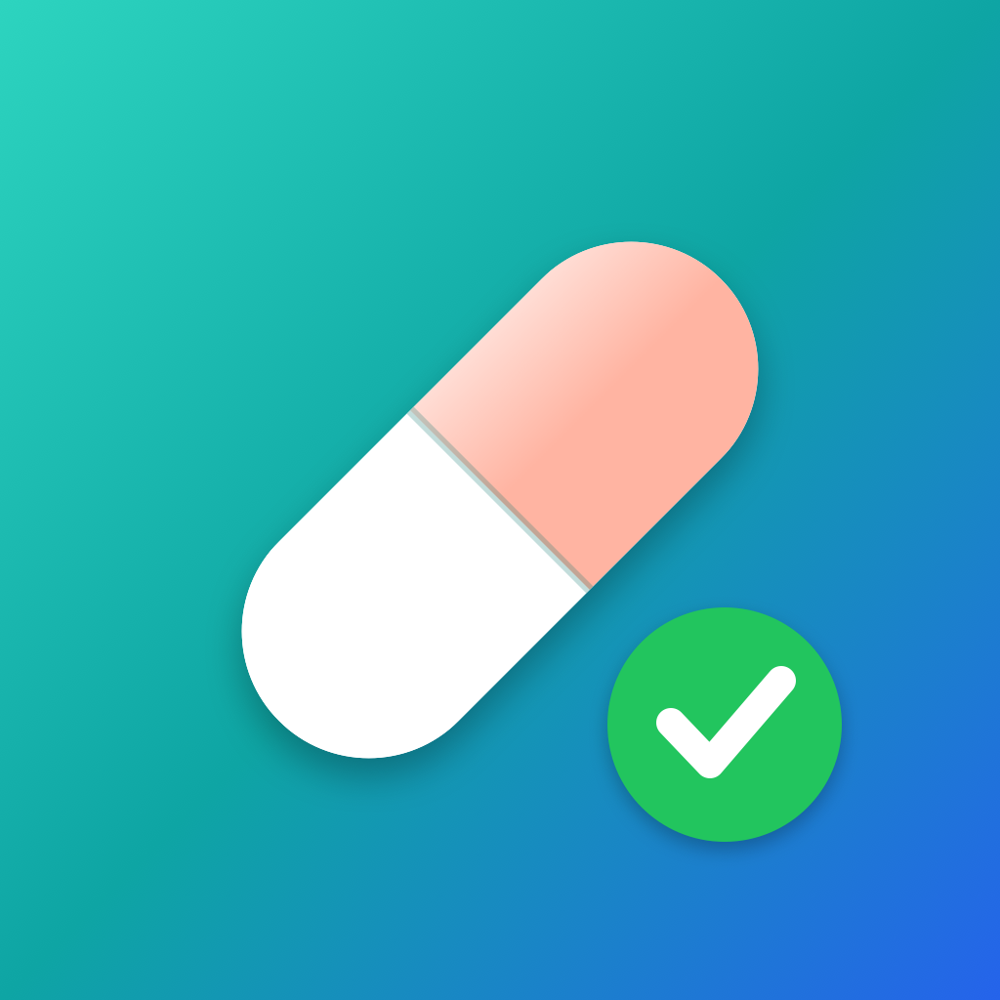

<p align="center">
  
</p>

<h1 align="center">LEKapp</h1>

<p align="center">
  Przypominanie o lekach i historia ich przyjmowania na iPhone, iPad, Mac i Apple Watch.<br>
  SwiftUI · SwiftData · WatchConnectivity · bez zewnętrznych zależności
</p>

---

## Spis treści

- [Funkcje](#funkcje)
- [Wymagania](#wymagania)
- [Uruchomienie w symulatorze](#uruchomienie-w-symulatorze)
- [Instalacja na iPhonie i Apple Watch](#instalacja-na-iphonie-i-apple-watch)
- [Flagi funkcji](#flagi-funkcji)
- [Płatne konto: iCloud i alerty krytyczne](#płatne-konto-icloud-i-alerty-krytyczne)
- [Struktura projektu](#struktura-projektu)
- [Jak to działa](#jak-to-działa)
- [Dane przykładowe do testów](#dane-przykładowe-do-testów)
- [Ograniczenia](#ograniczenia)
- [Wskazówki dla rozwoju](#wskazówki-dla-rozwoju)

## Funkcje

**Dziś**
- Lista dzisiejszych dawek z godziną i dawką; oznaczanie jako wzięte lub pominięte jednym dotknięciem i cofanie.
- Pierścień postępu, seria dni z kompletem dawek i ostrzeżenie, gdy kończy się zapas tabletek.

**Kalendarz**
- Widok miesiąca jak w aplikacji Kalendarz. Kropka pod dniem pokazuje, czy leki zostały wzięte:
  zielona – wszystkie, pomarańczowa – część, czerwona – żadna, szara – zaplanowane.
- Po dotknięciu dnia widać jego dawki; dawki z przeszłych dni można oznaczyć wstecz.
- Regularność w miesiącu i seria dni. Miesiące zmienia się strzałkami lub przesunięciem palca.

**Leki**
- Nazwa, dawka, kolor, symbol, godziny przyjmowania, dni tygodnia, notatki.
- Śledzenie zapasu tabletek z ostrzeżeniem przy niskim stanie.
- Lek krytyczny: wyróżniony i z ponownymi przypomnieniami, jeśli dawka nie zostanie oznaczona.
- Wstrzymanie leku oraz archiwum: lek znika z planu, ale jego historia zostaje w kalendarzu.

**Przypomnienia**
- Osobne powiadomienie dla każdej dawki z przyciskami „Wzięte ✓”, „Za 10 min” i „Pomiń”.
- Dawka oznaczona wcześniej (np. o 7:50 zamiast 8:00) nie wywoła już przypomnienia.

**Apple Watch**
- Dzisiejsze dawki i postęp dnia; oznaczanie dawek na zegarku.
- Dane przychodzą z iPhone'a przez WatchConnectivity – działa na darmowym koncie, bez iCloud.

## Wymagania

| | Minimalna wersja |
| --- | --- |
| Xcode | 27 (projekt w nowym formacie `project.xcproj`) |
| iOS / iPadOS | 18.6 |
| macOS | 15.6 |
| watchOS | 11.6 |
| Konto Apple | darmowe (Personal Team) wystarcza do wszystkiego poza iCloud i alertami krytycznymi |

## Uruchomienie w symulatorze

1. Otwórz `LEKapp.xcodeproj` w Xcode.
2. Wybierz schemat **LEKapp** i symulator iPhone'a, a następnie **Run** (⌘R).
3. Aplikację zegarka uruchomisz schematem **LekiWatch Watch App** na symulatorze Apple Watch sparowanym z tym iPhone'em.

Budowanie z terminala (bez podpisywania):

```bash
xcodebuild -project LEKapp.xcodeproj -scheme LEKapp -destination 'generic/platform=iOS Simulator' CODE_SIGNING_ALLOWED=NO build
```

Jeśli `xcodebuild` zgłasza, że wybrane są tylko Command Line Tools, przełącz na pełny Xcode:

```bash
sudo xcode-select -s /Applications/Xcode.app/Contents/Developer
```

## Instalacja na iPhonie i Apple Watch

### Przygotowanie (raz)

1. **Xcode → Settings → Accounts** – dodaj swoje Apple ID.
2. W obu targetach (**LEKapp** i **LekiWatch Watch App**) → **Signing & Capabilities**:
   zaznacz **Automatically manage signing** i wybierz swój **Personal Team**.
3. Podłącz iPhone'a kablem i stuknij **Zaufaj** na telefonie.
4. iPhone: **Ustawienia → Prywatność i ochrona → Tryb dewelopera** → włącz (telefon się zrestartuje).
   Opcja pojawia się po pierwszym podłączeniu do Xcode.
5. Apple Watch: **Ustawienia → Prywatność i ochrona → Tryb dewelopera** → włącz.
   Zegarek musi być sparowany z tym iPhone'em, najlepiej w tej samej sieci Wi-Fi co Mac.

### iPhone

1. Wybierz schemat **LEKapp** i swój iPhone jako urządzenie, potem **Run**.
   Pierwsze przygotowanie urządzenia może potrwać kilka minut.
2. Jeśli iPhone zablokuje aplikację: **Ustawienia → Ogólne → VPN i zarządzanie urządzeniem** →
   twój profil deweloperski → **Zaufaj**, i uruchom aplikację ponownie.
3. Przy pierwszym uruchomieniu zezwól na powiadomienia.

### Apple Watch

Aplikacja zegarka zwykle instaluje się razem z aplikacją na iPhone'a. Jeśli jej nie ma:

- **Z Xcode:** schemat **LekiWatch Watch App**, jako urządzenie twój zegarek, potem **Run**
  (pierwsze połączenie z zegarkiem może trwać kilkanaście minut), albo
- **Z iPhone'a:** aplikacja **Watch** → „Dostępne aplikacje” → **LekiWatch** → **Instaluj**.

Potem otwórz LEKapp na iPhonie – leki same przejdą na zegarek.
Na zegarku jest też przycisk **„Odśwież z iPhone'a”**.

> [!IMPORTANT]
> Na darmowym koncie aplikacja działa **7 dni**. Potem trzeba ją zainstalować ponownie z Xcode.
> **Dane zostają**, dopóki nie usuniesz aplikacji z urządzenia. Na jednym urządzeniu mogą być naraz
> maksymalnie 3 aplikacje zainstalowane z darmowego konta.

## Flagi funkcji

Wszystkie przełączniki są w jednym pliku: [`Shared/AppFeatures.swift`](Shared/AppFeatures.swift).

| Flaga | Domyślnie | Co robi |
| --- | --- | --- |
| `iCloudSyncEnabled` | `false` | synchronizacja leków i historii między urządzeniami przez iCloud (CloudKit) – **wymaga płatnego konta** |
| `watchSyncEnabled` | `!iCloudSyncEnabled` | synchronizacja iPhone ↔ zegarek przez WatchConnectivity; wyłącza się sama po włączeniu iCloud |
| `criticalAlertsEnabled` | `false` | alerty przebijające wyciszenie i „Nie przeszkadzać” – **wymaga płatnego konta i zgody Apple** |
| `criticalFollowUpMinutes` | `[5, 10]` | po ilu minutach ponowić przypomnienie o nieoznaczonej dawce leku krytycznego; `[]` wyłącza |
| `watchSchedulesOwnReminders` | `false` | zegarek planuje własne przypomnienia (mogą się dublować z powiadomieniami z iPhone'a) |
| `schedulingWindowDays` | `14` | na ile dni do przodu planowane są przypomnienia |
| `maxScheduledNotifications` | `60` | limit zaplanowanych powiadomień (iOS przyjmuje maks. 64) |

> [!WARNING]
> Na darmowym koncie zostaw `iCloudSyncEnabled` i `criticalAlertsEnabled` na `false`.
> Uprawnienia iCloud i alertów krytycznych blokują instalację aplikacji na urządzeniu.

## Płatne konto: iCloud i alerty krytyczne

Flaga włącza funkcję w kodzie, ale Apple wymaga też uprawnień (entitlements) w podpisie aplikacji.
Gotowe pliki są w folderze [`Config/`](Config) i domyślnie **nie są podpięte**.

| Plik | Zawiera |
| --- | --- |
| `LEKapp-Paid.entitlements`, `LekiWatch-Paid.entitlements` | iCloud (CloudKit), Push Notifications, powiadomienia „time sensitive” |
| `LEKapp-Paid+Critical.entitlements`, `LekiWatch-Paid+Critical.entitlements` | to samo + alerty krytyczne |

### Włączenie synchronizacji iCloud

1. W `AppFeatures.swift` ustaw `iCloudSyncEnabled = true`.
2. Target **LEKapp** → Build Settings → **Code Signing Entitlements** = `Config/LEKapp-Paid.entitlements`.
3. Target **LekiWatch Watch App** → **Code Signing Entitlements** = `Config/LekiWatch-Paid.entitlements`.
4. Jeśli zmienisz bundle ID, zmień też nazwę kontenera `iCloud.…` w obu plikach – musi być taka sama.
5. W iOS dodaj **Signing & Capabilities → Background Modes → Remote notifications**.
6. Wszystkie urządzenia muszą być zalogowane na to samo Apple ID.

Jeśli kontener iCloud nie utworzy się poprawnie, aplikacja sama wróci do bazy lokalnej.

### Włączenie alertów krytycznych

1. Złóż na developer.apple.com wniosek o uprawnienie **Critical Alerts** i poczekaj na zgodę Apple.
2. W `AppFeatures.swift` ustaw `criticalAlertsEnabled = true`.
3. Użyj plików `Config/*-Paid+Critical.entitlements` zamiast `*-Paid.entitlements`.

## Struktura projektu

```
LEKapp/
├── App_iOS_iPad_Mac/          aplikacja na iPhone, iPad i Mac
│   ├── LekiApp.swift           punkt wejścia (@main)
│   ├── RootView.swift          zakładki, odświeżanie przypomnień, dane przykładowe (DEBUG)
│   ├── TodayView.swift         ekran Dziś + wiersz dawki (DoseRow)
│   ├── MedCalendarView.swift   kalendarz z historią
│   ├── MedicationListView.swift lista leków i archiwum
│   ├── MedicationEditView.swift formularz leku
│   └── Theme.swift             kolory, karty, pierścień postępu
├── Watch/                     aplikacja na Apple Watch
│   ├── LekiWatchApp.swift
│   └── WatchTodayView.swift
├── Shared/                    wspólne dla wszystkich targetów
│   ├── AppFeatures.swift       flagi funkcji
│   ├── Models.swift            modele SwiftData: Medication, MedSchedule, DoseLog
│   ├── Persistence.swift       baza (lokalnie albo z iCloud)
│   ├── DoseEngine.swift        plan dnia, statystyki, seria dni, zapis dawek, historia planu
│   ├── NotificationService.swift przypomnienia
│   └── WatchSync.swift         synchronizacja iPhone ↔ zegarek
├── Config/                    uprawnienia na płatne konto (niepodpięte)
├── LEKapp/Assets.xcassets     ikona i kolor akcentu aplikacji
└── LekiWatch Watch App/Assets.xcassets  ikona zegarka
```

## Jak to działa

### Baza danych

Dane są w **SwiftData** (pod spodem SQLite), w trzech modelach:

| Model | Zawartość |
| --- | --- |
| `Medication` | lek i jego **bieżący** plan (godziny, dni tygodnia, aktywność), zapas, archiwum |
| `MedSchedule` | **wersje planu** leku, każda obowiązuje w przedziale `[validFrom, validTo)` |
| `DoseLog` | historia: dzień, minuta, status (wzięte/pominięte), nazwa i dawka leku z chwili zapisu, liczba odjętych tabletek |

Modele są zgodne z CloudKit: każda właściwość ma wartość domyślną, relacje są opcjonalne
i mają odwrotność, nie ma `@Attribute(.unique)`.

### Historia niezależna od planu

Zmiana godzin, dni albo wstrzymanie leku zamyka bieżącą wersję planu i otwiera nową **od tej chwili**
(`PlanHistory.sync`). Dzięki temu przeszłe dni w kalendarzu i seria dni liczą się według planu,
który wtedy obowiązywał. Jeśli plan powstał dziś i nie ma pod nim żadnej oznaczonej dawki,
poprawiany jest w miejscu, bez tworzenia nowej wersji.

### Liczenie dawek i serii

`DoseBook` buduje raz na odświeżenie widoku indeks historii (lek → dzień → minuta), więc kalendarz
i seria dni nie przeszukują wszystkich wpisów dla każdego dnia.

- **Wzięte** i **pominięte** – dawki oznaczone; pominięta liczy się jako niewzięta.
- **Nieoznaczona** – godzina minęła, a dawka nie jest oznaczona; liczy się jako niewzięta.
- **Zaplanowana** – godzina jeszcze nie nadeszła; nie wpływa na wynik dnia.
- Dawki sprzed dodania leku do aplikacji można oznaczyć, ale nieoznaczone się nie liczą.
- **Seria dni** – kolejne dni wstecz od dziś z kompletem dawek. Dni bez dawek nie przerywają serii,
  a dzisiejszy dzień nie przerywa jej, dopóki trwa.

### Przypomnienia

Każda dawka dostaje osobne, jednorazowe powiadomienie na najbliższe `schedulingWindowDays` dni,
z identyfikatorem `dose|<lek>|<dzień>|<minuta>`. Oznaczenie dawki usuwa jej przypomnienie,
ponowienia, drzemkę i baner z centrum powiadomień. Plan powiadomień jest przeliczany po każdej
zmianie danych i przy każdym otwarciu aplikacji.

### Synchronizacja z Apple Watch

- **iPhone jest źródłem danych.** Po każdym zapisie bazy wysyła na zegarek migawkę: leki, wersje planu
  i historię z ostatnich 7 dni (`updateApplicationContext`).
- **Zegarek** zmienia dawkę od razu u siebie i wysyła akcję do iPhone'a (`transferUserInfo` – kolejka,
  dostarczana także później). Akcje są idempotentne, a te, których iPhone jeszcze nie potwierdził,
  są nakładane na kolejne migawki.
- Zegarek nie planuje własnych przypomnień – pokazuje powiadomienia z iPhone'a, gdy telefon jest zablokowany.

## Dane przykładowe do testów

W wersji debug aplikacja może załadować dwa przykładowe leki. Działa to tylko na **pustej** bazie.

- **Xcode:** Product → Scheme → Edit Scheme → Run → Arguments → dodaj `-demoData`.
- **Symulator z terminala:**

```bash
xcrun simctl launch booted com.marcinsztukowskipersonalteam.LEKapp -demoData
```

## Ograniczenia

- **Okno przypomnień** – jeśli nie otworzysz aplikacji dłużej niż `schedulingWindowDays` dni,
  przypomnienia przestaną przychodzić.
- **Bez iCloud** dane są tylko na iPhonie (i jego kopii w zegarku). Mac i iPad mają osobne bazy.
- **Zegarek → iPhone** – gdy aplikacja na iPhonie jest całkiem zamknięta, dawka oznaczona na zegarku
  zwykle zapisze się dopiero przy następnym otwarciu LEKapp na telefonie.
- **Bez płatnego konta** powiadomienia „time sensitive” i alerty krytyczne działają jak zwykłe powiadomienia.
- **Darmowe konto** – aplikacja na urządzeniu działa 7 dni od instalacji.

## Wskazówki dla rozwoju

- **Nowe pole w modelu** – zawsze z wartością domyślną (wymóg CloudKit i automatycznej migracji SwiftData).
- **Nowy plik** – projekt ma jawną listę plików w `LEKapp.xcodeproj/project.xcproj`. Pliki z `Shared/`
  dodaj do obu targetów (`LEKapp` i `LekiWatch Watch App`).
- **Teksty interfejsu** są po polsku; język bazowy projektu to `pl`.
- **Ikony** są w `AppIcon.appiconset`: iOS (jasna, ciemna, tinted, 1024 px), macOS (16–1024 px) i watchOS (1024 px).
